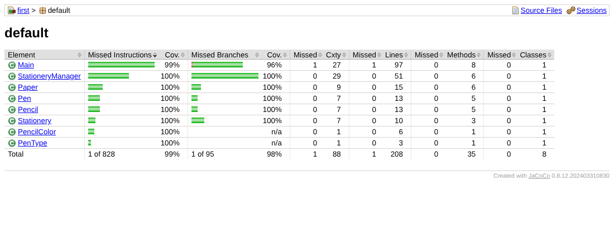
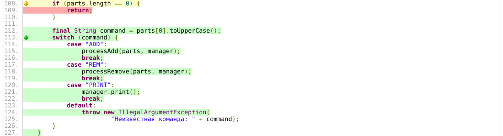

# first-tests — модульные тесты для программы из работы 3

Отдельный подпроект с модульными тестами для программы учёта канцелярских
принадлежностей из каталога `../first`. Код программы не копируется и не
меняется: тесты используют его напрямую. Gradle и Maven не нужны, все
библиотеки лежат в `lib/`.

```
репозиторий/
├── first/                      # программа (работа 3)
└── first-tests/                # этот подпроект
    ├── first-tests.iml         # модуль IntelliJ IDEA (зависит от модуля first)
    ├── src/                    # тесты (Test Sources Root)
    ├── lib/                    # junit-4.13.2, hamcrest-core-1.3, jacocoagent, jacococli
    ├── stub/                   # заглушка аннотации SpotBugs, только для run-tests
    ├── run-tests.bat           # запуск тестов и отчёта о покрытии (Windows)
    ├── run-tests.sh            # то же для Linux / macOS
    └── docs/                   # скриншоты отчёта о покрытии
```

**Важно:** папка `first-tests` должна лежать **рядом** с папкой `first`, а не
внутри неё. Корнем исходников модуля `first` является вся папка `first`, и
если положить тесты внутрь, они попадут в основной код программы.

## Как запустить

### Способ 1. IntelliJ IDEA (тесты и покрытие)

1. Откройте проект `first`, как обычно.
2. Подключите модуль с тестами: *File → Project Structure → Modules →* **+** *→
   Import Module →* выберите `first-tests/first-tests.iml` → OK.
3. В дереве проекта откройте `first-tests/src`, щёлкните правой кнопкой по
   `AllTests.java` (или по папке `src`) → **Run 'AllTests'**.
   Внизу появятся результаты: должно быть 97 зелёных тестов.
4. Покрытие: правой кнопкой по `AllTests.java` → **More Run/Debug → Run
   'AllTests' with Coverage**. Справа откроется окно *Coverage* с процентами
   по классам, а строки в редакторе подсветятся: зелёные покрыты, красные нет.
   Отчёт можно сохранить кнопкой *Generate Coverage Report* (HTML).

Если IntelliJ пишет, что модуль `first` не найден, проверьте в *Project
Structure → Modules → first-tests → Dependencies*, что в списке есть модуль
`first` и библиотека `junit4`.

### Способ 2. Командная строка (без IDE)

Нужна только JDK 17 или новее (`java` и `javac` должны быть в PATH).

- **Windows:** дважды щёлкните `run-tests.bat` или выполните в консоли:
  ```
  cd first-tests
  run-tests.bat
  ```
- **Linux / macOS:**
  ```
  cd first-tests
  ./run-tests.sh
  ```

Скрипт:
1. компилирует программу из `../first` в `out/main`;
2. компилирует тесты в `out/test`;
3. запускает все тесты (`AllTests`) через JUnit с агентом JaCoCo;
4. строит отчёт о покрытии **`coverage/html/index.html`**. Откройте его в
   браузере.

Ожидаемый вывод:
```
JUnit version 4.13.2
.................................................................................................
OK (97 tests)
```

## Состав тестов

Всего **97 тестов**, все проходят.

| Тестовый класс | Что проверяет | Тестов |
|---|---|---|
| `StationeryTest` | базовый класс: допустимая цена (в т. ч. 0); отказ при отрицательной цене, `NaN`, `±Infinity`, пустом или `null` телефоне | 8 |
| `PencilTest` | создание, геттеры, `getType`, `toString`, все цвета; отказ при твёрдости ≤ 0 и цвете `null` | 8 |
| `PenTest` | шариковая и гелевая ручки, `toString`; отказ при типе `null` и диаметре ≤ 0 | 7 |
| `PaperTest` | создание, `toString`; отказ при плотности, ширине или высоте ≤ 0 | 8 |
| `StationeryManagerTest` | вывод пустого и заполненного контейнера, `add(null)`, удаление по типу (`==`, `!=`, без учёта регистра, неизвестный тип), недопустимые операторы, допуск при `==` для цены | 12 |
| `StationeryManagerRemoveByPriceTest` | параметризованный: все 6 операторов `> < >= <= == !=`, включая граничные значения | 11 |
| `MainCommandTest` | разбор команд `ADD PENCIL/PEN/PAPER`, синонимы типа ручки (`BALL`, `ШАРИКОВАЯ`, `ГЕЛЕВАЯ`…), регистр и лишние пробелы, `PRINT`, `REM PRICE`, `REM TYPE` | 10 |
| `MainInvalidCommandTest` | **исключительные ситуации**, параметризованный: 28 вариантов неправильного ввода. Неизвестная команда или тип, неверное число аргументов, нечисловые значения, неизвестный цвет или тип ручки, нарушение ограничений, ошибки в `REM`. Для каждого проверяется, что выброшено `IllegalArgumentException` с понятным сообщением и что контейнер не изменился | 28 |
| `MainFileTest` | `main()` целиком: корректный файл, пропуск пустых строк и комментариев, сообщения «Ошибка в строке N» с продолжением работы после ошибки, пустой файл, **отсутствие файла** | 5 |

Вспомогательные классы:
- `AllTests` — набор (suite), который запускает все тесты сразу;
- `ConsoleCapture` — перехватывает `System.out`, чтобы проверять вывод программы;
- `MainTestSupport` — вызывает закрытый метод `Main.processCommand` через рефлексию.

`MainFileTest` создаёт временный `input.txt` в рабочем каталоге. Если там уже
есть настоящий `input.txt`, тест сначала сохраняет его в копию, а после
выполнения возвращает без изменений.

## Оценка покрытия кода тестами (JaCoCo)

| Метрика | Покрыто | Всего | % |
|---|---|---|---|
| Инструкции | 827 | 828 | **99,9 %** |
| Ветви (branches) | 94 | 95 | **98,9 %** |
| Строки | 207 | 208 | **99,5 %** |
| Методы | 35 | 35 | **100 %** |
| Классы | 8 | 8 | **100 %** |



Все классы, кроме `Main`, покрыты на 100 %. В `Main` не покрыта одна строка:



```java
final String[] parts = line.split("\\s+");
if (parts.length == 0) {
    return;            // недостижимо
}
```

Её нельзя выполнить ни при каком вводе. Метод вызывается только для
непустой строки после `trim()`, а `split("\\s+")` для такой строки всегда
возвращает хотя бы один элемент. Поэтому оставшиеся 0,5 % — это мёртвый код,
а не пропуск в тестах.

## Замечание, найденное при тестировании

`StationeryManager.removeByPrice` проверяет оператор только при сравнении с
очередным элементом. Поэтому на **пустом** контейнере команда с неверным
оператором (`REM PRICE ~ 10`) не сообщает об ошибке и выводит
«Удалено объектов: 0». Если контейнер не пуст, выбрасывается исключение, и
это покрыто тестом. Чтобы исправить, оператор нужно проверять до цикла, как
это уже сделано в `removeByType`.
